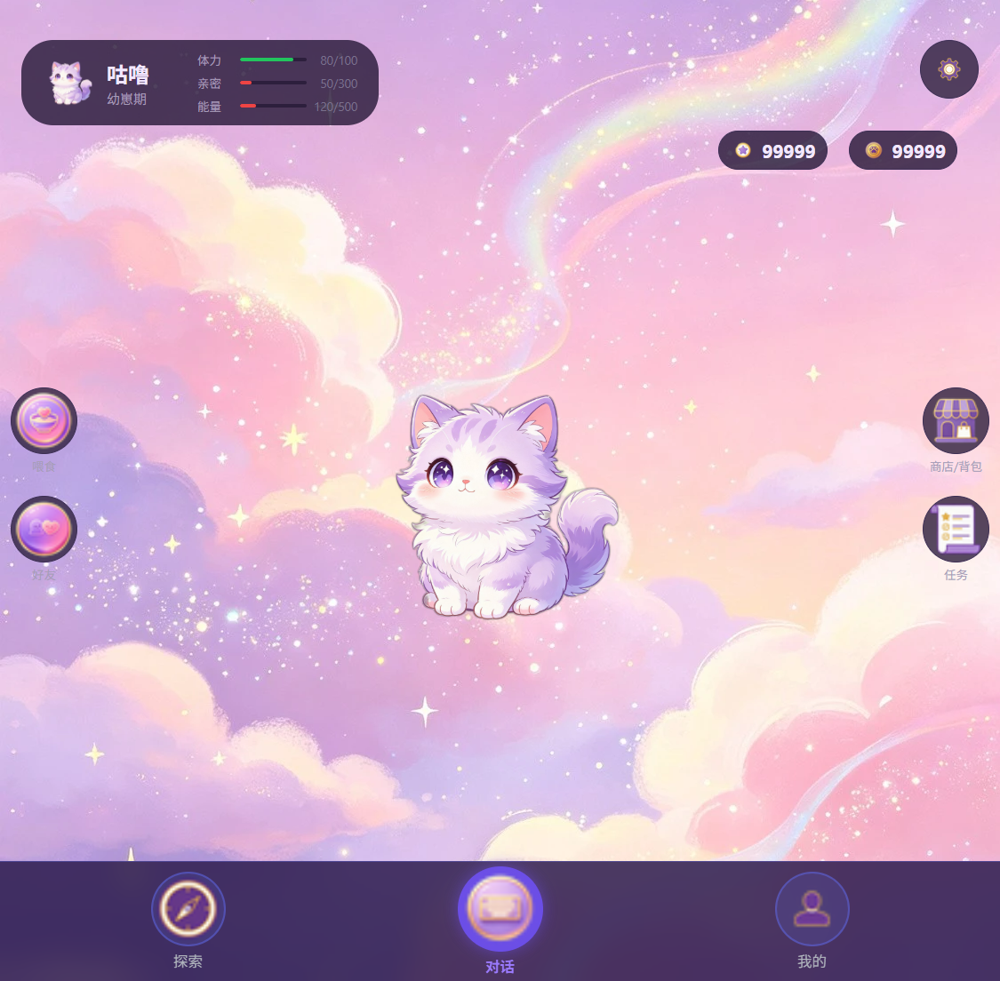

# 【生活娱乐赛道】咕噜 Gulu —— 你的 AI 情绪陪伴宠物

> Demo 帖初稿，截图已保存到 `docs/screenshots/`，Session ID 与线上体验链接留好占位符，等 Zeabur 部署完成后替换即可。

---

## 一、Demo 简介

**咕噜 Gulu** 是一只长在你手机里的 AI 情绪陪伴宠物。它不只存在于聊天窗口，而是会和你一起散步、探索城市、慢慢成长。

核心玩法：

- **7 步降生法**：通过破冰邀请、MBTI 能量场、星座选择，生成一只符合你性格的专属宠物。
- **主界面陪伴**：宠物会根据时间、互动产生情绪变化；喂食、换装、进化都在一个画面完成。
- **探索世界**：基于高德地图的 LBS 探索，点击「推荐」即可展开 AI 个性化攻略卡片，找到附近适合你的 Citywalk、咖啡馆、日落机位。
- **情绪疗愈**：和咕噜对话、完成每日任务，帮助它从「灰化」状态恢复，也帮助自己整理情绪。

> 体验地址：**[Zeabur 部署完成后的前端域名，占位符]**
>
> 后端 API：**[Zeabur 部署完成后的后端域名，占位符]**

---

## 二、创作思路

### 1. 真实场景：为什么想做咕噜？

我身边很多朋友会养「电子宠物」解压，但大多数产品只有点击喂食，缺少「被理解」的感觉。疫情期间我自己也有过情绪低落的时候，当时很希望有一个不需要社交压力、但能感知我状态的小存在。

所以我想做一个 **「把 MBTI/星座画像 + LBS 城市探索 + AI 对话」结合起来的情绪陪伴宠物**：它知道你大概是什么样的人，知道你在哪个城市，能给你推荐「今天适合去的地方」，而不是冷冰冰地推送攻略。

### 2. 规划时先反问，再动手

在 TRAE 里规划方案时，我刻意让 AI 先反问几个问题，再给出技术方案。这样做的好处是逼我把需求想得更具体。

几次关键问答：

- **Q1：用户最想要的陪伴感，来自宠物外观还是对话？**
  - 结论：两者都需要，但「外观即时反馈」优先级更高——所以先做了宠物情绪动画、主界面交互轮盘、进化 Ceremony。
- **Q2：真地图 + 真数据，还是假地图 + 假数据？**
  - 讨论见下一节，这是整个项目最关键的取舍之一。
- **Q3：MVP 要多少个界面？**
  - 结论：聚焦 onboarding → 主界面 → 探索 → 对话，其他用弹窗或半屏模态承载，避免一次做 20 个页面。

### 3. 真数据 + 真地图，还是假数据 + 假地图？

这是我和 TRAE 讨论最久的一个点。

| 方案 | 优点 | 缺点 |
|------|------|------|
| 假地图 + 假数据 | 开发快、截图稳定 | 评审一眼假，无法体现 LBS 价值 |
| 真地图 + 真数据 | 体验真实、能讲清城市探索故事 | 需要高德 key、需要后端聚合 POI/内容、截图受网络影响 |

最终取舍：

- **地图用真的**：接入高德 JS API + 后端高德 POI，保证缩放、标记、附近用户都是真实地理位置。
- **推荐内容用「内存降级 + 真实推荐接口」**：后端有 `recommendation_service`，无外部 key 时会自动降级到内存里的北京南锣鼓巷/什刹海攻略，保证 Demo 在没有 SiliconFlow/DeepSeek key 时也能稳定运行；有 key 时则走真实 embedding + AI 生成推荐语。
- **附近用户先用模拟数据**：因为社交功能需要审核和隐私方案，初赛先让 UI 跑通，后端接口已留好。

这样截图出来有真实地图、真实推荐卡片，体验链路完整，同时不会因为缺少第三方 key 而崩掉。

### 4. 用 TRAE 生成资产

咕噜的视觉资产分三块：

- **UI 图标/按钮**：让 TRAE 按统一风格描述生成，再裁剪成 PNG。
- **宠物形象**：通过提示词迭代，生成了一只紫白色、云朵星空风格的幼崽猫，作为主界面宠物。
- **主界面背景**：生成了一张粉色-紫色渐变、带彩虹和星云的梦幻天空背景，替换掉原来的深紫纯色渐变。

资产统一用 `AssetManager` 管理路径，避免截图时路径写死导致 404。

---

## 三、TRAE 实践过程

### 关键截图

#### 1. Onboarding 破冰邀请

> 截图说明：引导页从「让我听见你」的呼吸光球开始，点击后进入昵称/MBTI 表单。这是用户第一次和咕噜建立连接的瞬间。

#### 2. 主界面（宠物中心 + 新背景）

> 截图说明：主界面换上了新生成的梦幻天空背景，左上角宠物面板显示体力 80/100、亲密 50/300、能量 120/500；底部三按钮和两侧功能按钮的图标已调整为 cover 填充，铺满圆形按钮。

#### 3. 探索页 —— 点击「推荐」展开攻略卡片

> 截图说明：高德地图为底，显示真实 POI 标记和附近用户；点击左侧「推荐」后，底部弹出可横向滑动的 AI 推荐卡片，包含标题、摘要、推荐理由和数据来源。

### 关键 Prompt / 操作记录

1. ** onboarding 可重复触发**
   - 问题：为了截图，需要让 onboarding 从 welcome 开始，但 store 默认会跳过。
   - 操作：在 `onboardingStore.ts` 把 `currentStep` 默认值改为 `'welcome'`，并临时注释 `onRehydrateStorage` 里强制 completed 的逻辑；在 `OnboardingFlowScreen.tsx` 里加临时 `reset()` 保证从 welcome 启动。截图完成后已移除临时 reset。

2. **主界面背景没更新**
   - 问题：生成了 `bg_home_gradient.webp`，但主界面还是深紫色。
   - 根因：`Background.tsx` 里 `GRADIENT_SCENES` 的 `home` 配置覆盖了图片背景。
   - 修复：注释掉 `home` 配置，让主界面走 `BACKGROUND_MAP` 的图片背景。

3. **按钮图标铺不满圆形**
   - 问题：图标 PNG 本身有透明边，`resizeMode: 'contain'` 导致图标很小。
   - 修复：把 `SideMenu` / `BottomNavBar` 的圆形容器加 `overflow: 'hidden'`，图标改为 `resizeMode: 'cover'` 并放大尺寸，让图标填满圆圈。

4. **探索推荐卡片截图**
   - 问题：本地推荐接口依赖后端，初次点击可能空白。
   - 修复：启动后端 `uvicorn main:app --port 8000`，确认 `recommendations/contents` 接口在无外部 key 时自动降级到内存攻略数据，再点击「推荐」截图。

### Session ID 占位符

> 按比赛要求，需附上不少于 3 个 Session ID，证明作品由 TRAE 完成。

- Session ID 1：`[xxxxxxxx-xxxx-xxxx-xxxx-xxxxxxxxxxxx]`
- Session ID 2：`[xxxxxxxx-xxxx-xxxx-xxxx-xxxxxxxxxxxx]`
- Session ID 3：`[xxxxxxxx-xxxx-xxxx-xxxx-xxxxxxxxxxxx]`

---

## 四、踩坑与经验总结

### 1. 状态持久化会「绑架」截图

Zustand + persist 让 onboarding 进度被存到 localStorage，导致刷新后永远回不到 welcome。为了截图，必须手动清 localStorage 或临时改默认值。**经验**：截图前一定要想清楚「哪些状态是演示状态，哪些是用户状态」，演示状态最好有 reset 开关。

### 2. React Native Web 的样式和原生端不完全一致

`overflow: 'hidden'` 在部分场景下不会自动跟随 `borderRadius` 裁剪子元素，需要显式声明；`resizeMode` 写在 style 里会报 warning，但功能正常。**经验**：Web 截图优先用 CSS 思维验证，遇到显示问题先用浏览器 DevTools 看实际渲染盒模型。

### 3. 第三方 API 是 Demo 稳定性的最大敌人

高德、DeepSeek、SiliconFlow 都可能因为 key、网络、配额导致流程中断。**经验**：核心业务接口必须做降级。比如推荐服务在没有 key 时返回内存攻略，后端没有 Redis/Supabase 时也能启动。Demo 评审不会因为「缺少 key」而给你第二次机会。

### 4. 截图要「可复现」

第一次截图主界面时，宠物体力是 0/100，原因是 pet store 里没有宠物。后来通过给 localStorage 注入一份合理的 pet 状态，才截到体力 80/100 的主界面。**经验**：不要依赖随机数据截图，提前构造一份稳定的演示数据。

### 5. Zeabur 部署配置从 YAML 切到 JSON

最早尝试 `zeabur.yaml` 配置多服务，但 Zeabur 对根目录静态服务的识别更依赖 `zbpack.json`。最终改成：

- 根目录 `zbpack.json` 定义前端构建命令和输出目录；
- `backend/Dockerfile` 定义后端服务；
- `DEPLOY.md` 记录手动在 Zeabur 控制台添加两个 Git Service 的步骤。

**经验**：PaaS 平台的配置文件格式会随版本变化，部署前先看官方最新文档，不要在一种格式上死磕。

---

## 五、后续计划

1. 等 Zeabur 前后端都部署成功后，把「体验地址」和「后端 API 地址」填回本文占位符。
2. 把 Session ID 替换为实际参赛时 TRAE 的会话 ID。
3. 继续接入真实的小红书/抖音内容源，让推荐内容从「内存攻略」走向「实时抓取 + 向量检索」。
4. 增加宠物语音和 Web Push，让陪伴感从视觉延伸到听觉和提醒。

---

**标签**：生活娱乐  
**作品名**：咕噜 Gulu  
**作者**：[你的昵称]  
**体验地址**：[占位符]  
**开源仓库**：https://github.com/Chyusen/gulu.git
