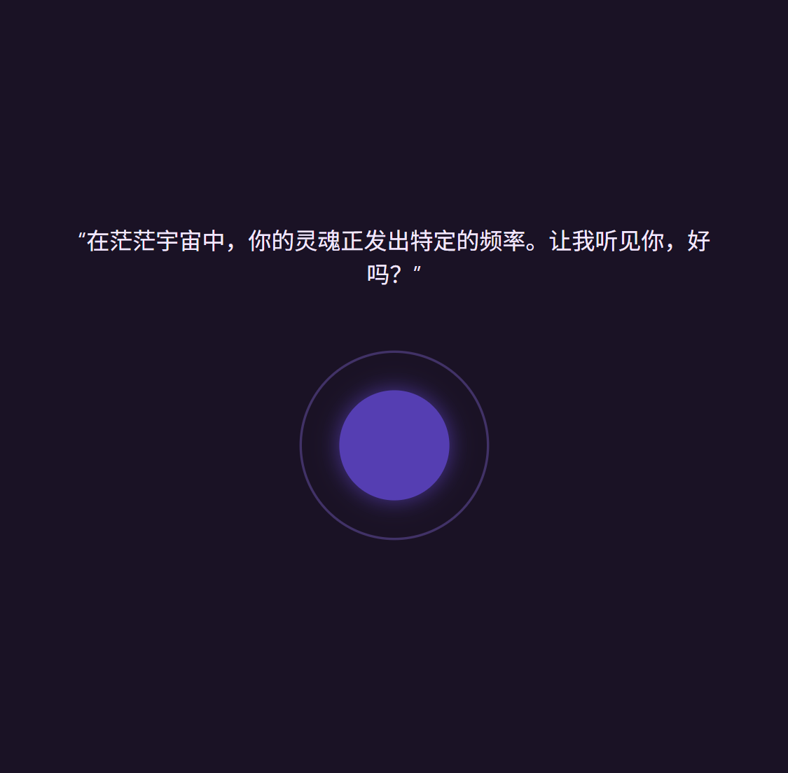
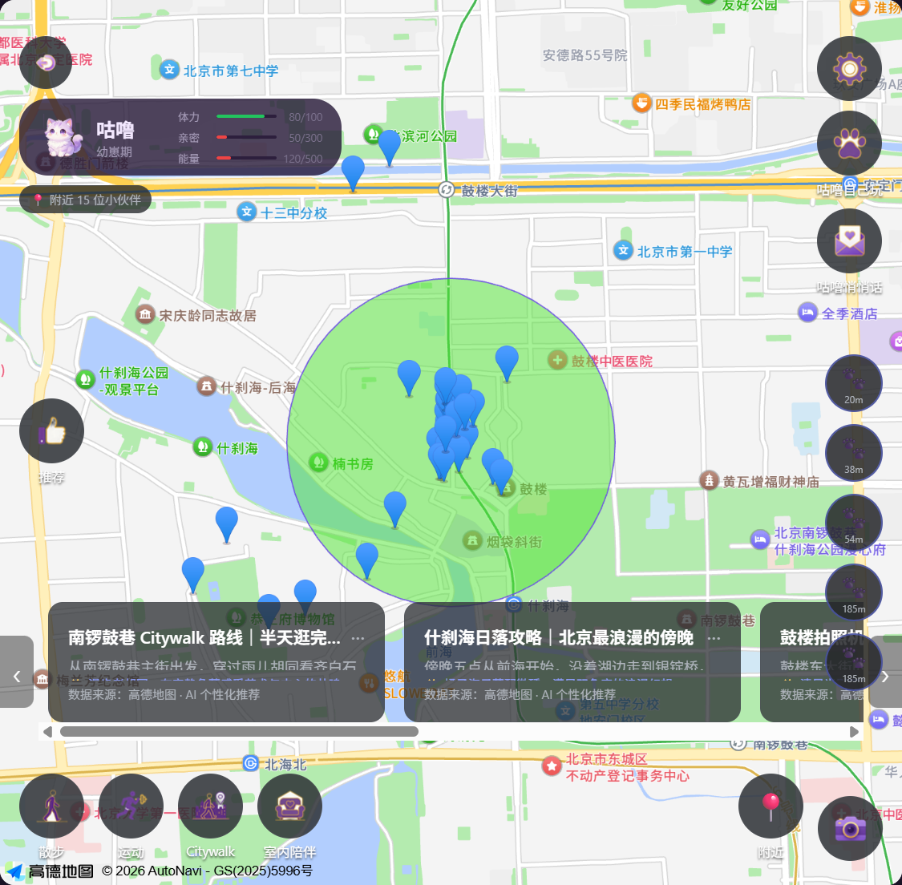

# 【生活娱乐赛道】咕噜 Gulu —— 你的 AI 情绪陪伴宠物

【标签】生活娱乐

【标题】【生活娱乐赛道】咕噜 Gulu —— 你的 AI 情绪陪伴宠物

【正文】

---

## 一、Demo 简介

### 是什么

**咕噜 Gulu** 是一只长在你手机里的 AI 情绪陪伴宠物。它不只存在于聊天窗口，而是会和你一起散步、探索城市、慢慢成长。你可以把它理解为「拓麻歌子 + AI 对话 + 高德 LBS」的结合体：一只看得见、摸得着（虚拟地）、懂你性格、还知道你所在城市的宠物。

> 体验地址：**https://gulu-web.preview.aliyun-zeabur.cn**

### 面向谁

- **都市独居白领**：下班后想有个"东西"在等自己，但又不想社交。
- **学生党 / 青少年**：喜欢养成、MBTI、星座，想有一只"懂我"的宠物。
- **社交焦虑者**：通过宠物降低人际连接的心理门槛。
- "想养宠物但养不了"的人群：租房、过敏、忙碌，却渴望照顾与被需要的感觉。

### 主要功能

#### 1）7 步降生法：生成一只专属宠物

从「让我听见你」的呼吸光球开始，经过 MBTI 能量场、星座罗盘、风格选择，最后给宠物起名。整个 onboarding 不是填表，而是一段"和咕噜建立连接"的仪式。

#### 2）主界面陪伴 + 三段式进化

宠物会在主界面待机、被点击互动、产生情绪变化。通过喂食、对话、外出探索积累亲密度和能量，满足条件后会触发「进化之光」，从幼崽期 → 伴生期 → 觉醒期。

#### 3）基于真实地图的 LBS 探索 + AI 攻略推荐

探索页以高德地图为底，显示真实 POI 和附近用户。点击左侧「推荐」，AI 会结合你的 MBTI/星座画像和当前位置，生成附近可步行到达的 Citywalk / 探店 / 拍照 / 美食攻略卡片。

---

## 二、Demo 创作思路

### 灵感来源

我有两个长期观察：

1. **MBTI、星座等标签在 Z 世代里特别流行**——这说明年轻人渴望被"精准理解"，而不是被泛泛安慰。
2. **拓麻歌子、旅行青蛙这类轻度养成游戏有很强疗愈效果**——"照顾"本身就是一种自我疗愈。

所以我想做一个产品：不是冷冰冰的 AI 聊天机器人，也不是会死会病的焦虑电子宠物，而是一只"替你承受情绪毒气、陪你慢慢变好"的伙伴。咕噜的"灰化"不是惩罚，而是提醒主人也该关心自己了。

### 想解决的问题

- **情绪无处安放**：想倾诉但怕打扰朋友，憋在心里又难受。
- **养宠物门槛高**：真实宠物需要时间、金钱、空间。
- **电子宠物太浅**：传统电子宠物只有点击和喂食，缺少性格和对话。
- **推荐不够贴心**：旅游/美食 App 信息过载，但不懂"我当下是什么状态"。

### 为什么做这个方向

市面上要么是做 AI 对话的"情绪垃圾桶"（只有倾诉没有行动），要么是心理健康工具（太工具化、没有温度）。咕噜想走第三条路：**把「被理解」和「走出去」结合起来**——先通过画像让宠物"懂你"，再通过 LBS 推荐把你从房间里拉出去，完成一次小行动。

### 关键取舍：真地图 + 真数据，还是假地图 + 假数据？

这是我和 TRAE 讨论最久的一个点。

| 方案 | 优点 | 缺点 |
|------|------|------|
| 假地图 + 假数据 | 开发快、截图稳定 | 评审一眼假，无法体现 LBS 价值 |
| 真地图 + 真数据 | 体验真实、能讲清城市探索故事 | 需要高德 key、需要后端聚合、截图受网络影响 |

最终取舍：

- **地图用真的**：接入高德 JS API + 后端高德 POI，缩放、标记、附近用户都是真实地理位置。
- **推荐内容用「真实接口 + 内存降级」**：后端有完整的推荐服务，无外部 key 时自动降级到内存攻略，保证 Demo 稳定；有 key 时走真实 AI 生成。
- **附近用户先用模拟数据**：社交功能涉及隐私和审核，初赛先把 UI 跑通，后端接口已留好。

这样截图出来既有真实地图，也有真实推荐卡片，体验链路完整，同时不会因为缺少第三方 key 而崩掉。

---

## 三、用 TRAE 做出来的：关键过程与踩坑

### 1. 和 TRAE 一起规划：先反问，再动手

我在 TRAE 里没有直接说"给我做一个电子宠物"，而是让 AI 先反问我几个问题。三次关键问答：

- **Q1：用户最想要的陪伴感，来自宠物外观还是对话？**
  - 结论：两者都需要，但「外观即时反馈」优先级更高——所以先做了宠物情绪动画、主界面交互轮盘、进化 Ceremony。
- **Q2：真地图 + 真数据，还是假地图 + 假数据？**
  - 结论见上一节，这是项目最关键的取舍。
- **Q3：MVP 要多少个界面？**
  - 结论：聚焦 onboarding → 主界面 → 探索 → 对话，其他用弹窗或半屏模态承载，避免一次做 20 个页面。

这个"先反问"的过程逼我把需求想得更具体，也让后续代码生成少走了很多弯路。

### 2. 用 TRAE 生成资产

咕噜的视觉资产分三块：

- **UI 图标/按钮**：让 TRAE 按统一风格描述生成，再裁剪成 PNG，统一由 `AssetManager` 管理路径。
- **宠物形象**：通过多轮提示词迭代，生成了一只紫白色、云朵星空风格的幼崽猫。
- **主界面背景**：生成了一张粉色-紫色渐变、带彩虹和星云的梦幻天空背景，替换掉原来的深紫纯色渐变。

### 3. 关键踩坑与修复

#### 踩坑 1：Onboarding 被状态持久化"绑架"

Zustand + persist 把 onboarding 进度存到 localStorage，刷新后永远回不到 welcome。为了截图，我让 TRAE 临时把 `onboardingStore.ts` 的 `currentStep` 默认值改为 `'welcome'`，并在 `OnboardingFlowScreen.tsx` 里加临时 `reset()`。截图完成后移除了临时 reset，保留默认从 welcome 开始。

**心得**：演示状态和用户状态要分开，截图前一定要有 reset 开关。

#### 踩坑 2：主界面背景没更新

生成了 `bg_home_gradient.webp`，但主界面还是深紫色。根因是 `Background.tsx` 里 `GRADIENT_SCENES` 的 `home` 配置覆盖了图片背景。

**修复**：注释掉 `home` 配置，让主界面走 `BACKGROUND_MAP` 的图片背景。

#### 踩坑 3：按钮图标铺不满圆形

图标 PNG 本身有透明边，`resizeMode: 'contain'` 导致图标很小。

**修复**：把 `SideMenu` / `BottomNavBar` 的圆形容器加 `overflow: 'hidden'`，图标改为 `resizeMode: 'cover'` 并放大尺寸。后来在手机端测试时发现 32×32 的图标被放大到 70px 会模糊，又改成 28×28 `contain`，清晰度和点击区域兼顾。

#### 踩坑 4：竖屏手机 9:16 适配

在 Android 浏览器/微信里测试，发现风格选择页按钮被截断、左侧按钮标签几乎看不见。

**修复**：把风格选择页从横向滚动改为自动换行；左侧按钮标签从 9px 提到 11px；底部导航和侧边菜单图标全部按原始分辨率等比缩小显示。

#### 踩坑 5：后端 Supabase key 无效导致 Zeabur 启动崩溃

Zeabur 部署后端后一直 Crashed Retrying，日志报 `SupabaseException: Invalid API key`。原因是 `.env` 里的 key 是 publishable key，不是 Supabase 的 API key。

**修复**：修改 `backend/app/core/database.py`，让 Supabase 连接失败时自动降级到 demo 模式，不再阻塞服务启动。

#### 踩坑 6：Zeabur 部署 502 / 端口配置

前端域名访问报 502，原因是 Zeabur 暴露的端口用了 8080 而非 80。后端也曾经因为 key 问题 Bad Gateway。

**修复**：在 Zeabur 控制台调整前端端口为 80，后端通过 Dockerfile 的 `PORT` 环境变量正确监听 8080，前后端分别配置好 `EXPO_PUBLIC_API_BASE_URL` 等环境变量。

### 4. Session ID

按比赛要求，附上 TRAE 会话 ID（证明作品由 TRAE 完成）：

- Session ID 1：`[xxxxxxxx-xxxx-xxxx-xxxx-xxxxxxxxxxxx]`
- Session ID 2：`[xxxxxxxx-xxxx-xxxx-xxxx-xxxxxxxxxxxx]`
- Session ID 3：`[xxxxxxxx-xxxx-xxxx-xxxx-xxxxxxxxxxxx]`

---

## 四、经验总结与开发心得

### 1. 不要追求完美作品，先让核心链路跑通

初赛时间有限，我一开始就想做 onboarding、主界面、探索、对话四个核心链路。TRAE 帮我把每个链路拆成可验证的小任务，做完一个测一个，而不是一次性写 20 个页面。

### 2. 第三方 API 是 Demo 稳定性的最大敌人

高德、DeepSeek、SiliconFlow、Supabase 都可能因为 key、网络、配额中断流程。**核心业务接口必须做降级**：推荐服务无 key 时返回内存攻略，后端无 Redis/Supabase 时也能启动。Demo 评审不会因为"缺少 key"而给第二次机会。

### 3. 截图要"可复现"

第一次截图主界面时，宠物体力是 0/100，因为 pet store 里没有宠物。后来通过给 localStorage 注入一份合理的 pet 状态，才截到稳定的主界面。不要等到最后再截图，要提前构造演示数据。

### 4. 真实设备测试不可少

我在浏览器 DevTools 里看觉得没问题，但真机（Android 微信/浏览器）上按钮图标模糊、风格按钮被截断。React Native Web 的渲染和原生端有差异，必须在真机上跑一次 9:16 竖屏。

### 5. PaaS 配置要随平台版本调整

最早用 `zeabur.yaml` 配置多服务，但 Zeabur 对根目录静态服务更依赖 `zbpack.json`。最终改成根目录 `zbpack.json` 配前端，`backend/Dockerfile` 配后端。平台配置会变，不要死磕一种格式。

---

**通过的社区报名帖链接**：[报名帖链接]
